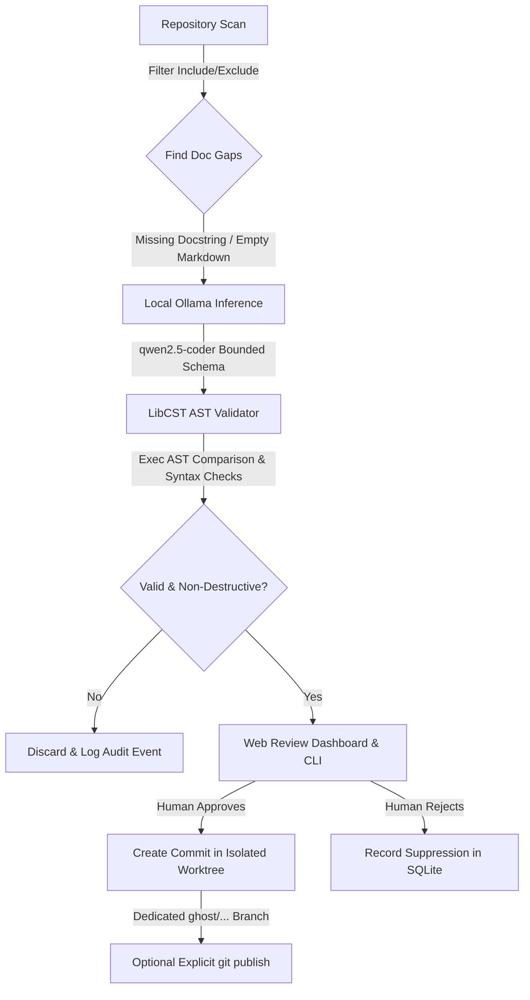

<div align="center">

# 👻 The Ghost Contributor
### *Small documentation chores. Local models. Your final say.*

[](LICENSE)
[](pyproject.toml)
[](https://ollama.com)
[](https://github.com/Instagram/LibCST)
[](docs/CHALLENGE.md)
[](#-quickstart-guide)

<p align="center">
  <b>An autonomous, review-first local AI assistant that quietly maintains your repository's documentation without cloud leaks or unexpected branch tampering.</b>
</p>

[⚡ Quickstart](#-quickstart-guide) •
[🔍 How It Works](#-how-it-works) •
[✨ Key Features](#-key-features) •
[🖥️ Review Dashboard](#%EF%B8%8F-local-review-dashboard) •
[🛡️ Safety Architecture](#%EF%B8%8F-safety-architecture--guardrails) •
[📚 Documentation Index](#-documentation-index)

</div>

---

## 🌟 Overview

Documentation chores—like writing missing function docstrings or filling in empty README headers—are vital for code health, yet they constantly get pushed down the backlog.

**The Ghost Contributor** is an autonomous, review-first AI contributor built on the principle of **Slow and Steady** open innovation:
- **Zero Cloud Dependence**: Runs 100% locally using **Ollama** (`qwen2.5-coder:1.5b` or `7b`). No code ever leaves your machine.
- **LibCST Non-Destructive Transformations**: Ensures docstrings are injected with exact syntax preservation, retaining comments, encoding cookies, CRLF/LF line endings, and original AST structure.
- **Isolated Git Worktrees**: All proposed changes are staged in disposable Git worktrees on dedicated `ghost/...` branches. Your current branch, unstaged files, and active editor sessions are never touched.
- **Review-First Experience**: Every change generates an evidence quote, confidence metric, and unified diff. You retain full human veto power via a token-authenticated web UI or interactive CLI.

> 🏆 **Built for the Hacktoberfest 2026 / DEV Challenge (Slow & Steady Track)**  
> *Release: **v0.2.1 (Review-First MVP)**. Designed for real-world local utility, grounded verification, and transparent safety boundaries.*

---

## 🔍 How It Works



1. **Detection**: Ghost scans registered repositories for narrow, high-value documentation chores (missing public Python function docstrings or marked empty Markdown sections).
2. **Local Inference**: Sends an evidence-backed prompt to your local Ollama instance on loopback (`http://127.0.0.1:11434`). Cloud features are strictly bypassed.
3. **AST Validation**: Injects proposed docstrings using LibCST and validates that the executable AST remains identical—guaranteeing no runtime logic changes.
4. **Human Review**: Generates a unified diff and presents it in a secure, local web UI.
5. **Attributed Commit**: Upon approval, Ghost creates an attributed commit in an isolated Git worktree.

---

## ✨ Key Features

| Feature | Description |
|---|---|
| 🔒 **100% Local & Private** | Strict loopback requests, proxy bypass, redirect refusal, and no external telemetry. |
| 🧠 **Open-Weight Models** | Built for `qwen2.5-coder:1.5b` (fast/lightweight) and `qwen2.5-coder:7b` via Ollama. |
| 🛡️ **LibCST AST Verification** | Validates Python syntax, executable AST equivalence, and golden formatting preservation. |
| 🌲 **Worktree Isolation** | Protects your working tree; checks dirty trees, detached HEADs, and rebases before running. |
| 🖥️ **Web Review Dashboard** | Token-protected single-page app displaying diffs, citations, rationale, and 1-click approvals. |
| ⏱️ **Scheduled Daemon** | IANA timezone support, quiet hours, missed-run coalescing, and system-level file locks. |
| 📜 **Tamper-Evident Audit Trail** | Append-only SQLite state with cryptographic hash chaining for complete provenance. |

---

## ⚡ Quickstart Guide

### 🪟 Windows Setup (Fast Track)

We provide 1-click batch scripts for seamless setup on Windows:

1. **Prerequisites**: Ensure [Git](https://git-scm.com/) and [Python 3.11–3.13](https://www.python.org/) are installed.
2. **Start Local Ollama**: Close any Ollama tray application, then run:
   ```cmd
   start-ollama-local.bat
   ```
   *(This launches Ollama with `OLLAMA_NO_CLOUD=1` to ensure local-only inference).*
3. **Run Windows Setup Wizard**:
   ```cmd
   setup-windows.bat
   ```
   Select your installed Ollama model by number and enter the path of a Git repository (or press Enter to generate a sample sandbox repo).
4. **Launch Dashboard**:
   ```cmd
   start-ghost.bat
   ```
   Open the browser URL printed in the terminal (including `#token=...`) to review and approve proposals!

> 📖 *For a bilingual Hindi/English step-by-step walkthrough, see [START-HERE-WINDOWS.md](START-HERE-WINDOWS.md).*

---

### 🐧 Linux & 🍎 macOS Setup

1. **Install and Start Ollama**:
   ```bash
   # Pull recommended lightweight coding model
   ollama pull qwen2.5-coder:1.5b
   
   # Start Ollama with cloud features disabled
   OLLAMA_NO_CLOUD=1 ollama serve
   ```

2. **Install Ghost Contributor**:
   ```bash
   git clone https://github.com/Rohi56u/Ghost-contributer.git
   cd Ghost-contributer
   python3 -m venv .venv
   source .venv/bin/activate
   pip install -e .
   ```

3. **Configure & Run**:
   ```bash
   # Verify local models
   ghost models

   # Run guided onboarding setup
   ghost setup

   # Register a repository manually (optional)
   ghost repo add /path/to/your-repo --name myrepo --model qwen2.5-coder:1.5b
   ghost doctor --repo myrepo

   # Execute a single dry-run
   ghost run --repo myrepo --once --dry-run

   # Launch the Web Review UI
   ghost dashboard
   ```

---

### 🧪 Optional Fixture Demo (Zero Inference Required)

Want to inspect the UI and Git worktree engine without loading an AI model? Run the built-in fixture demo:

```bash
# Windows
start-demo.bat

# Linux / macOS
ghost demo
ghost --home ./ghost-demo/state dashboard
```
*Demonstrates scanning, review, diff visualization, and a real local Git worktree commit using deterministic fixture prose.*

---

## 🖥️ Local Review Dashboard

The Ghost dashboard is a lightweight, responsive web application served exclusively from your local loopback address:

```text
  ┌─────────────────────────────────────────────────────────────────┐
  │ 👻 Ghost Contributor  •  myrepo [qwen2.5-coder:1.5b]            │
  ├─────────────────────────────────────────────────────────────────┤
  │ Proposal #12: Add missing docstring for `parse_config()`       │
  │ File: src/core/config.py (Lines 42-68)                          │
  │ Model Confidence: High (Uncertainty: None)                      │
  ├─────────────────────────────────────────────────────────────────┤
  │ +    """                                                        │
  │ +    Parse application configuration from a YAML or JSON file.  │
  │ +    Returns a validated ConfigSchema instance.                 │
  │ +    """                                                        │
  ├─────────────────────────────────────────────────────────────────┤
  │ [ Reject Proposal ]                        [ Approve & Commit ] │
  └─────────────────────────────────────────────────────────────────┘
```

- **Token Authenticated**: Generates a cryptographically random session token on startup.
- **Evidence Inspection**: Shows exact source quotes, AST verification logs, and model metadata.
- **Diff Export**: Download raw unified diff patches directly from the interface.

---

## 💻 CLI Command Reference

| Command | Action |
|---|---|
| `ghost init` | Initialize global Ghost Contributor state (`~/.ghost-contributor`). |
| `ghost models` | Enumerate locally installed Ollama models and digests. |
| `ghost setup` | Interactive numbered setup wizard for first-time onboarding. |
| `ghost repo add <path> --name <id>` | Register a repository with strict path boundaries. |
| `ghost doctor --repo <id>` | Run pre-flight health checks (Git status, Ollama connection, branch state). |
| `ghost run --repo <id> [--dry-run]` | Scan for doc gaps and generate a candidate proposal. |
| `ghost review latest` | Inspect the latest pending proposal and diff in the terminal. |
| `ghost approve <id> [--yes]` | Approve a proposal and commit to an isolated `ghost/...` branch. |
| `ghost publish <id>` | Explicitly push an approved proposal branch to the remote origin. |
| `ghost daemon` | Start the scheduled background runner (IANA timezone & quiet hours). |
| `ghost audit` | Print tamper-evident hash-chained event logs. |
| `ghost pause` / `ghost resume` | Temporarily suspend or resume background daemon activity. |

---

## 🛡️ Safety Architecture & Guardrails

Ghost Contributor operates under strict defense-in-depth safety boundaries:

1. **Fail-Closed Git Gatekeeper**:
   - Refuses execution if working tree is dirty, HEAD is detached, or a rebase/merge/cherry-pick is in progress.
   - Refuses untracked files and symlinks.
2. **Strict Loopback-Only Networking**:
   - Hard-bound to `127.0.0.1` / `::1`.
   - Refuses HTTP redirects, proxies, and remote endpoints.
3. **AST Invariance (LibCST)**:
   - Validates that the Python AST before and after modification produces an exact executable match (excluding the newly inserted docstring).
   - Preserves encoding cookies, BOM headers, comments, tabs, and trailing newlines.
4. **Model Confinement**:
   - The AI model cannot specify file paths, run shell commands, or modify policy configuration. Output is strictly bounded by JSON schemas.
5. **No Blind Remote Pushes**:
   - Remote publishing is **never** automated. It requires an explicit `ghost publish <id>` CLI invocation by the user.

---

## 📚 Documentation Index

| Document | Purpose |
|---|---|
| 📖 [START-HERE-WINDOWS.md](START-HERE-WINDOWS.md) | Windows quickstart walkthrough in conversational Hinglish. |
| 🏛️ [ARCHITECTURE.md](docs/ARCHITECTURE.md) | Deep dive into LibCST engine, state machines, and worktrees. |
| 🛡️ [SECURITY.md](docs/SECURITY.md) | Security threat model, local state isolation, and recovery. |
| 📋 [PRD-COVERAGE.md](docs/PRD-COVERAGE.md) | Exact matrix of implemented MVP features vs. original PRD. |
| 📄 [The-Ghost-Contributor-PRD.pdf](docs/The-Ghost-Contributor-PRD.pdf) | Original Product Requirement Document specification. |
| 🔬 [REAL-RUN.md](docs/REAL-RUN.md) | Empirical record of a live run using `qwen2.5-coder:7b`. |
| ⚖️ [MODEL-EVALUATION.md](docs/MODEL-EVALUATION.md) | Comparison of Ollama candidate models and licenses. |
| 🗺️ [ROADMAP.md](docs/ROADMAP.md) | Future direction: TypeScript support, auto PRs, and multi-file. |
| 🛠️ [TROUBLESHOOTING.md](TROUBLESHOOTING.md) | Solutions for port conflicts, Ollama memory, and Git lock errors. |
| 🎯 [CHALLENGE.md](docs/CHALLENGE.md) | DEV Challenge Hacktoberfest 2026 submission details. |

---

## 🧪 Testing & Verification

The test suite thoroughly exercises the LibCST editor, Git worktree isolation, safety barriers, and HTTP network sandboxing:

```bash
# Install development dependencies
pip install -e ".[dev]"

# Run comprehensive test suite
pytest -v
```

Verified test coverage includes:
- Staged, unstaged, and untracked dirty tree aborts.
- Byte-for-byte line-ending (CRLF/LF) and encoding preservation.
- Malformed model JSON handling and schema validation.
- Non-loopback network rejection and redirect blocks.
- Isolated worktree lifecycle and atomic rollbacks.

---

## 🤝 Contributing

Contributions are welcome! Please read [CONTRIBUTING.md](CONTRIBUTING.md) before opening a pull request or submitting an issue.

```bash
# Run linters and tests before committing
pytest -q
```

---

## 📜 License & Attribution

- **License**: [MIT License](LICENSE) © 2026 Kartik.
- **Dependencies**: LibCST, Python, Git, and Ollama retain their respective open-source licenses.
- **AI Disclosure**: Developed with AI pair-programming assistance for architecture design and test synthesis.

---

<div align="center">

### 🏷️ Discoverability & Tags

`#AI` • `#Ollama` • `#OpenSource` • `#LocalLLM` • `#Python` • `#LibCST` • `#Git` • `#Hacktoberfest` • `#DeveloperTools` • `#Automation` • `#CodeQuality` • `#DevChallenge` • `#QwenCoder`

**Star ⭐ this repository if you believe in local, private AI developer tools!**

</div>
