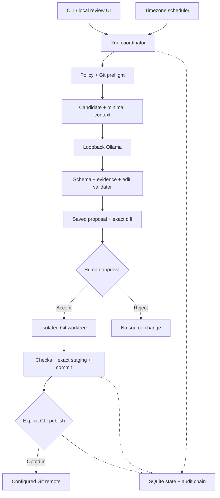
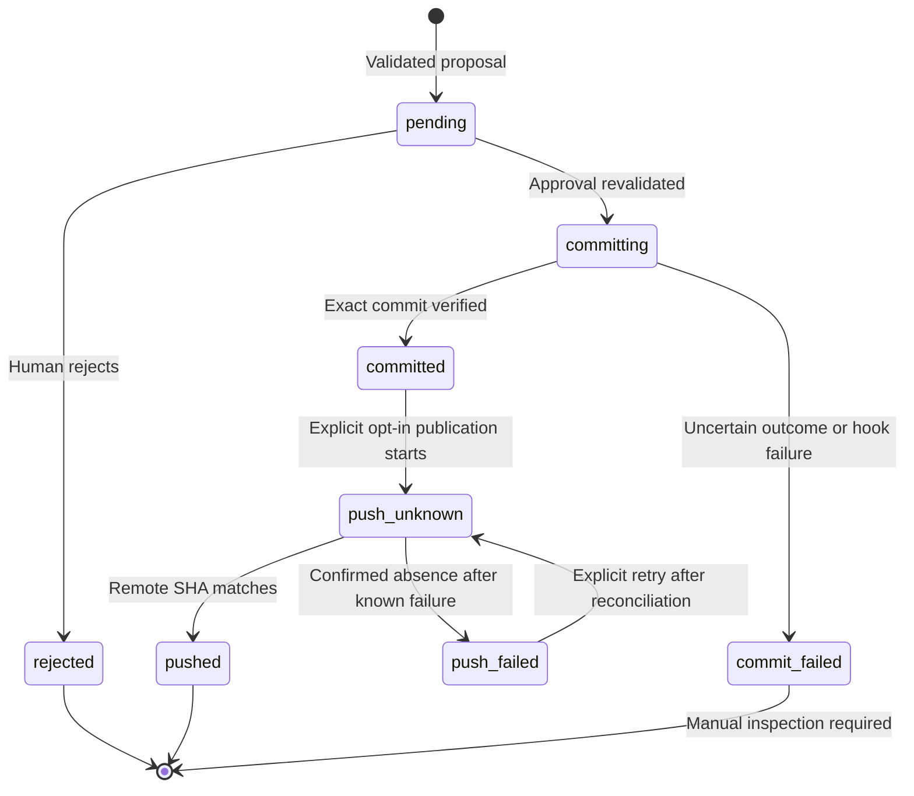

# Architecture: The Ghost Contributor

Status: implemented local MVP, version 0.2.1. Design review date: October 22, 2026.

## Product thesis

The valuable unit is an accepted, useful documentation correction with a small review cost. A developer registers a few repositories, specifies what may be touched and reviews concrete suggestions. The system earns permission through predictable boundaries. Its advantage is the integrated maintenance workflow: discovery, minimum context, evidence, safe editing, review and recoverable delivery.

“Top tier” is an outcome to measure through retained changes, review effort and maintainer feedback. It is not a property established by adding more frameworks. The initial design uses one local process, one database and a small parser-backed editing surface so the failure modes remain inspectable.

## Component boundaries



All components except the optional Git remote live on the developer's machine. The browser talks only to a loopback HTTP service. The UI never calls Ollama directly and never receives Git credentials. The model has no tools, subprocess access, schema authority or file-write permission.

## Stack and reasons

| Layer | Implemented choice | Reason and tradeoff |
|---|---|---|
| Runtime | Python 3.11–3.13 | Git/process/filesystem integration; native packaging; source parser alignment. |
| AI transport | Standard-library HTTP to Ollama | One small network boundary; exact local address; no proxies or redirects. Less dependency surface than an agent framework. |
| Default model | Configurable `qwen2.5-coder:1.5b` | Small starting candidate with a verified catalog license; quality must be evaluated locally. Optional 7B model, no automatic download. |
| Editing | LibCST 1.8.6 + Python AST | CST preserves bytes/formatting; AST checks executable structure. The model supplies prose, not a patch. |
| Policy | TOML + strict dataclass validation | Human-editable, fail-closed fields; model output cannot modify configuration. |
| State | SQLite, WAL, unique run keys | Transactional run reservation; no hosted database; explicit crash states. |
| Audit | Append-only SQLite events + SHA-256 chain | Detects accidental record mutation; not tamper-proof against the machine owner. |
| Delivery | Git subprocess argument arrays | Exact staging/refspecs; existing auth and hooks; no shell interpolation. |
| Scheduler | Calendar slots + zoneinfo + OS locks | Predictable local behavior and DST rules without a queue service. |
| UI | Local HTTP server + HTML/CSS/JavaScript | No Node build or network assets for end users; backend remains authoritative. Local-only scope, not an Internet server. |
| Verification | Pytest + temporary Git remotes + local HTTP fixtures | Checks failures that can lose work, leak context or publish incorrectly. |

No Redis, Kubernetes, vector database or cloud model is required. Retrieval is a bounded source excerpt, not a repo-wide embedding index. React can be introduced if the interface becomes complex enough to justify its build and maintenance cost.

## Main contracts

### Installed-model onboarding

`ghost models` reads the local `/api/tags` inventory. `ghost setup` offers a numbered selector, excludes cloud references and verifies the selected model with `/api/show` before registration. Reported embedding-only models are refused. Setup does not pull models or generate prose. Existing repositories must pass normal preflight; the optional sample is a new, committed Git repository with explicit byte-preserving attributes. Its first user-initiated run calls the selected Ollama model through the same production pipeline.

The setup wizard saves review mode, disables remote push, sets a 180-second request timeout and disables quiet hours for the first test. Later model/timeout changes go through policy validation and invalidate pending approval receipts. Server cloud-disable confirmation is an operator acknowledgement, not cryptographic proof of server egress configuration.

### Repository policy

The registered canonical root itself is the approved filesystem boundary. Files must also be tracked, supported, within include patterns, outside excluded/generated/secret-like paths, not ignored, and not symlinks. The current branch and clean-tree status are hard gates. Unsupported index flags are rejected because they can hide worktree changes.

Policy fingerprints bind proposals to the complete generation policy. Any policy change before approval invalidates the saved proposal. Remote push permission is checked again at publication; remote destination identity is recorded before an attempted push and pinned for recovery.

### Target selection

The user backlog takes precedence. Without one, sorted eligible Python files are examined for an unambiguous, public, undecorated function with multiple statements and a missing docstring. Trivial, single-line, duplicate-name and already-documented functions are skipped. At most one proposal is created per repository per run. Already handled targets on the same base SHA are not generated again.

Markdown requires an empty `ghost:<section>:start/end` region plus an explicitly allowed evidence file. Arbitrary README rewrites are intentionally absent from v0.2.

### Model response

```json
{
  "target": "retry.py",
  "rationale": "The public helper has no docstring; its return expression supplies evidence.",
  "replacement_text": "Return the exponential retry delay capped at cap.",
  "evidence": [{
    "path": "retry.py",
    "start_line": 4,
    "end_line": 4,
    "quote": "return min(base * (2 ** attempt), cap)"
  }],
  "uncertainty": "none"
}
```

Exact keys, string/array bounds, target identity, original line ranges and literal evidence quotes are checked in application code. Extra fields are rejected. The model's uncertainty is visible to the reviewer. Quote matching does not prove the summary follows from the quote; that requires review and a model evaluation set.

### Deterministic transformation

The generator never returns executable code or a general patch. For Python, the application locates one function by CST position, inserts one escaped docstring statement and requires that removing that single added line reconstructs the original bytes. Before/after ASTs are compared with semantic docstrings stripped. The candidate must parse and compile without execution and remain unchanged under a repeated transform.

This preserves executable syntax, comments and whitespace in supported fixtures. It does not prove identical behavior under `__doc__` inspection. Decorated functions are excluded in the first version because decorators may inspect documentation during definition.

### Approval receipt

The stored receipt combines base SHA, full policy fingerprint and candidate-byte digest. Approval rechecks each against current source and reruns the deterministic transform. Existing source snapshots are retained in the private state database, outside the repository. The UI displays the same stored diff that the commit pipeline verifies.

## Persistence

| Table | Key | Main fields | Mutation rules |
|---|---|---|---|
| `runs` | `id`, unique `(repo, period)` | status, timestamp, controlled detail code | Reserve once; update terminal result. |
| `proposals` | `id` | repo, status, timestamps, JSON payload | Explicit state transitions; snapshots retained for recovery. |
| `flags` | key | paused/killed | Immediate stop flags, read at operation boundaries. |
| `audit` | sequence | canonical event JSON, prior hash, current hash | INSERT only through application; SQL triggers refuse UPDATE/DELETE. |

Proposal JSON stores base SHA, policy hash, target metadata/source excerpt, model identity, evidence, before/after bytes, diff digest, validation outcomes, branch, optional commit SHA and remote identity. Audit events store metadata and digests, not full source or raw stderr. Retention is not automated in v0.2; the recovery guide explains safe manual archival.

## Delivery state machine



No crash recovery path blindly repeats a commit. A `committing` or `commit_failed` record blocks further automatic proposals until the developer inspects the retained worktree and branch. Publishing first checks remote state. An indeterminate push is never retried automatically and never escalates to force-push.

## Concurrency and schedule

- One state-directory operation lock serializes run/approve/reject/publish.
- A per-user lock derived from Git's common-directory identity also serializes multiple state directories or linked worktrees targeting the same repository.
- SQLite's unique task key is the durable idempotency gate after process restart.
- Daily period key = timezone + local calendar date + configured wall time. Missed days collapse to the latest slot.
- During a DST fall-back overlap, the same date/time key is used twice but only one run is reserved. During a skipped spring-forward hour, the slot becomes due after the jump.
- Quiet hours are checked when the run starts and before automatic local approval. A manual, explicit approval is permitted outside the schedule.
- Version 0.2 records an operational failure and waits for the next slot or a manual run. Automated retry backoff is deferred rather than silently repeating side effects.

## Failure handling

| Situation | Outcome |
|---|---|
| Dirty worktree / unexpected branch | Safe stop before context generation. |
| No supported gap | Logged no-op; no model request or commit. |
| Model missing, remote model, malformed response | Controlled failure; no source edit. |
| Invalid evidence, parse failure, span mismatch | Proposal rejected before it reaches approval. |
| Base or policy changed | Approval refused; generate a fresh proposal. |
| Check failed | Disposable validation checkout removed; no source commit. |
| Hook changes approved commit | Mark failed, retain worktree for inspection; never publish automatically. |
| Remote default branch unavailable | Fail closed; initialize or fix remote HEAD. |
| Push timeout | Reconcile remote SHA; preserve unknown result if inaccessible. |
| Process dies | OS lock releases; durable states prevent blind duplication. |

## Extension design

A later language adapter should expose `discover`, `context`, `apply`, `verify` and a golden fixture suite. Keep policy, approval receipts, state and Git delivery independent of the language. Existing-doc rewrites need explicit span hashes and a semantic review benchmark before broader unattended use. A future GitHub App should have minimal repository permissions, server-side protected-branch rules and a separate publication boundary.

Sources: [Ollama structured output](https://docs.ollama.com/capabilities/structured-outputs), [Ollama local-only behavior](https://docs.ollama.com/faq), [LibCST rationale](https://libcst.readthedocs.io/en/latest/why_libcst.html), [Python AST](https://docs.python.org/3/library/ast.html), [Git worktree](https://git-scm.com/docs/git-worktree). The source PRD was supplied by Kartik; implementation decisions and scope changes are documented here and in PRD-COVERAGE.md.
